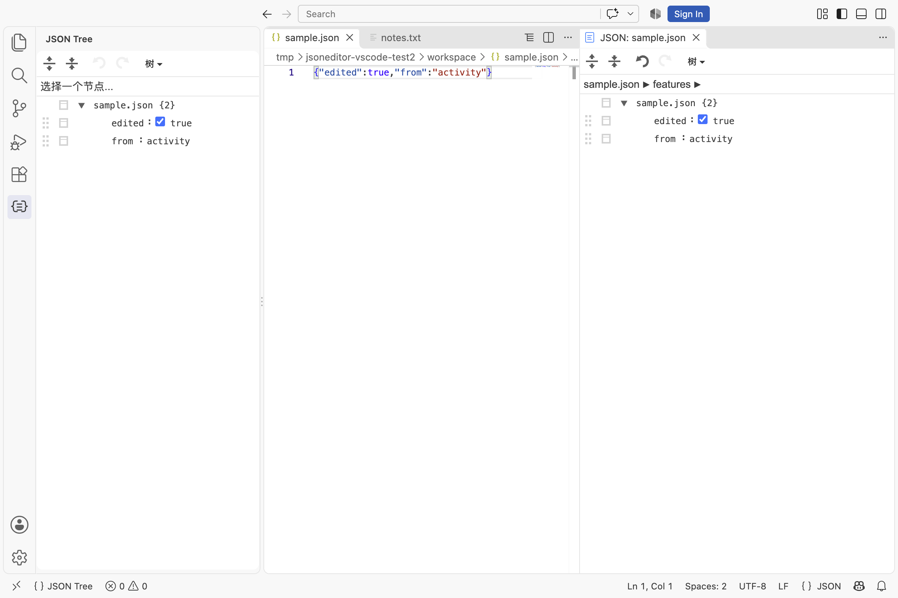
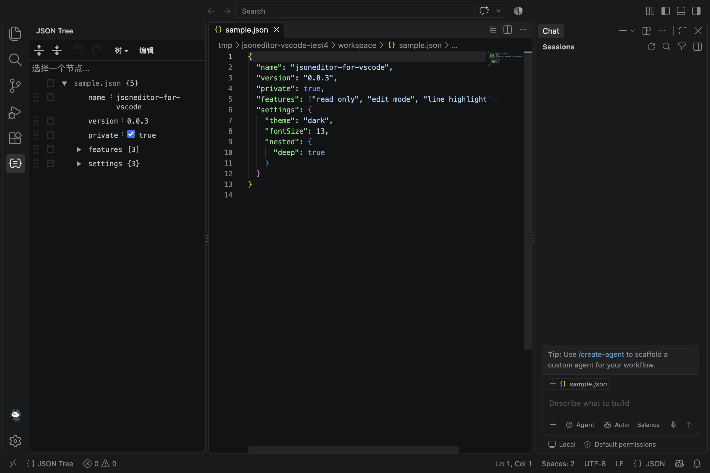

# JSON Tree for VS Code

[English](README.md) | [简体中文](README.zh-CN.md)

View and edit the active JSON file in VS Code as an interactive tree. The extension uses [jsoneditor](https://github.com/josdejong/jsoneditor) and keeps its views in sync with the VS Code document.

## Features

- Open the active JSON file from the Activity Bar, the status bar, or the Command Palette.
- Switch between tree, code, text, and preview modes.
- Search JSON keys and values with jsoneditor's built-in search field.
- Compare the current document with pasted JSON in a full-webview, side-by-side jsoneditor workspace. Navigate between highlighted differences.
- Toggle between edit and read-only modes.
- Sync edits to the VS Code document. Save changes with the normal VS Code save command.
- Select a tree node to reveal and highlight its source location.
- Keep multiple JSON Tree views synchronized with the same document.
- Follow VS Code light, dark, and high-contrast themes.
- Show parse errors for invalid JSON. JSONC is not supported.

## Screenshots

| Light theme | Dark theme |
| --- | --- |
|  |  |

## Installation

Build a VSIX package from the source:

```bash
pnpm install
pnpm package
```

The package command creates a `.vsix` file in the project root using the
current version in `package.json`. For a release build, run
`pnpm package:release` and choose patch, minor, or major when prompted. It uses
`bumpp` to increment the selected version and then creates the VSIX without
committing, tagging, or pushing to Git.
Upload the generated file manually through the Marketplace Publisher portal.
In VS Code, open the Extensions view, select **Install from VSIX...** from its
**...** menu, and choose the generated file. You can also install it from the
command line:

```bash
code --install-extension ./jsoneditor-for-vscode-*.vsix
```

The `publisher` field in `package.json` must match your Marketplace publisher
ID. Test the generated VSIX locally before uploading; Marketplace releases
cannot reuse an existing version number.

## Usage

1. Open a standard `.json` file.
2. Open the **JSON Tree** view in the Activity Bar, select **JSON Tree** in the
   status bar, or run **JSON Editor: 打开 JSON 树形视图** from the Command Palette.
3. Use the toolbar to switch modes and toggle edit or read-only mode.
4. Select **Diff**, paste the baseline JSON, and compare both documents side by side in the full editor area. Use the previous and next controls to navigate differences.
5. In edit mode, press `Cmd+S` on macOS or `Ctrl+S` on Windows and Linux to save.

Edits are immediately synced to the VS Code document and marked as unsaved.
They are not written to disk until you save. In read-only mode, the save command
can still save changes already present in the document.

## Development

The project uses pnpm and requires VS Code 1.90 or later.

```bash
pnpm install
pnpm build
```

Open the project in VS Code and press `F5` to launch the Extension Development
Host. The following commands are also available:

```bash
pnpm check     # TypeScript type-check and build
pnpm package   # Create a VSIX package
```

Open `test/preview.html` in a browser to preview the webview without VS Code.
Use query parameters such as `?theme=dark`, `?theme=light`, `?error=1`, or
`?mode=code` to preview different states.

## Contributing

Bug reports and improvements are welcome. Before submitting a pull request,
describe the purpose of the change and how you tested it. Run `pnpm check`;
include screenshots for interface changes.

## License

This project is licensed under the [Apache License 2.0](LICENSE). See
[THIRD-PARTY-NOTICES.md](THIRD-PARTY-NOTICES.md) and `third-party/` for notices
and licenses for bundled dependencies.
